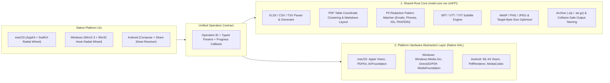

# ADR-001: Hybrid Cross-Platform Engine Architecture (Rust Core + Native OS Acceleration)

- **Status**: Proposed & Accepted for Phase 3–6
- **Platforms**: macOS (Swift 6), Windows (Rust / WinUI 3), Android (Kotlin + Jetpack Compose)

---

## Context

As the product expands from a native macOS app into a cross-platform ecosystem (**macOS**, **Windows**, **Android**), rewriting every file parser, spreadsheet converter, table extractor, and redaction rule three times in Swift, C#, and Kotlin would triple maintenance cost and cause behavior drift across platforms.

At the same time, certain capabilities—such as **Neural Background Removal**, **On-Device OCR**, and **Hardware Video Encoding**—are already built into modern operating systems (Apple Vision & VideoToolbox on macOS, Windows.Media.Ocr & DirectML on Windows, Google ML Kit & MediaCodec on Android). Bundling portable C/Rust replacements for those (like FFmpeg + Tesseract + ONNX weights) would bloat the app binary from **3 MB to 250+ MB** and run slower than hardware-accelerated OS APIs.

---

## Decision: Two-Tier Hybrid Engine with a Single Operation Contract

We will split the processing architecture into **two clean layers** behind one shared **Operation Contract**:

### 1. What Moves into `meld-core` (Rust + Mozilla UniFFI)
Pure, deterministic, CPU-bound file transformations that should behave identically byte-for-byte on macOS, Windows, and Android:
- **Collision-Safe Output Naming & File Routing** (`OutputNaming`, `FileCategory`, `OperationSpec` registry)
- **Spreadsheets & Delimited Data** (`XLSX`, `CSV`, `TSV`, `JSON`, `YAML` parsing, formatting, and table layout math)
- **PDF Table Clustering & Markdown Reconstruction** (clustering text bounding boxes into rows/columns and exporting `.xlsx` / `.md`)
- **PII Detection & Redaction Rules** (detecting emails, phone numbers, credit cards, SSN/PAN, currency amounts, and custom keywords, returning normalized bounding boxes to burn)
- **Subtitle & Transcript Engine** (`SRT` ↔ `VTT` ↔ clean `TXT`)
- **Target-Byte-Size Compression Loop & Lossless WebP** (`< 200 KB`, `< 500 KB`, `< 1 MB`, `< 2 MB` binary-search quality/scale controller)
- **Archives** (`.zip`, `.tar`, `.tar.gz` creation and safe extraction)

### 2. What Stays in the Native Platform HAL
Hardware-accelerated neural and media pipelines provided by the host OS:
- **OCR & Barcode/QR Scanning**: Apple `Vision` (macOS) · `Windows.Media.Ocr` (Windows) · Google `ML Kit` (Android)
- **1-Click Background Cutout**: `VNGenerateForegroundInstanceMaskRequest` (macOS) · DirectML Subject Segmentation (Windows) · ML Kit Subject Segmentation (Android)
- **Hardware Video & Audio Transcoding**: `AVFoundation` (macOS) · `MediaFoundation` (Windows) · `MediaCodec` (Android)

---

## Consequences

- **Tiny Binary Size**: Keeping neural weights and video codecs delegated to the OS keeps the desktop and mobile installers under **5–10 MB**.
- **Single Source of Truth for Business Logic**: Fixing a CSV edge case, adding a new PII redaction rule, or adding a new petal operation in `meld-core` immediately ships to macOS, Windows, and Android via **UniFFI** (which auto-generates Swift, Kotlin, and C/Windows bindings from a single Rust crate).
- **Zero Disruption to Current macOS App**: We can extract modules into `meld-core` one engine at a time while `FlipDocCore` continues to pass all existing Swift tests.
