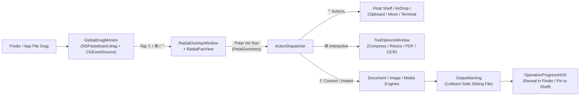

# FlipDoc Architecture Overview

FlipDoc is structured as a modular Swift 6 package separating the lightweight executable entry point (`FlipDoc`) from the reusable, testable core framework (`FlipDocCore`).

---

## Repository Layout

```text
flipdoc/
├── Config/
│   └── Info.plist                                # macOS LSUIElement accessory bundle configuration
├── Docs/
│   ├── ARCHITECTURE.md                           # Architectural design & data flow
│   └── PRD.md                                    # Product requirements & feature matrix
├── Scripts/
│   └── build-app.sh                              # Release builder, CoreGraphics .icns generator & ad-hoc codesigner
├── Sources/
│   ├── FlipDoc/
│   │   └── main.swift                            # Minimal @MainActor NSApplication bootstrap
│   └── FlipDocCore/
│       ├── App/
│       │   ├── ActionDispatcher.swift            # Central router for Actions, Tool Sheets, and async Engine tasks
│       │   ├── FlipDocAppDelegate.swift          # Accessory lifecycle, global drag monitor & drop pill startup
│       │   └── MenuBarController.swift           # NSStatusItem menu & quick file picker triggers
│       ├── Core/
│       │   ├── AppPreferences.swift              # UserDefaults-backed settings & recent conversion store
│       │   ├── FileType.swift                    # UTType/extension classifier & context-aware FanOption matrix
│       │   ├── OutputNaming.swift                # Collision-safe non-destructive sibling file/folder naming
│       │   └── SoundAndHaptics.swift             # In-memory WAV tick synthesizer & trackpad haptics
│       ├── Engines/
│       │   ├── Document/
│       │   │   ├── DocumentTools.swift           # PDF split/merge/compress/images, textutil, subtitles & archives
│       │   │   ├── PDFMarkdownConverter.swift    # Font-size heading heuristic + Vision OCR fallback -> Markdown
│       │   │   ├── PDFTableExtractor.swift       # PDFKit character-bounds XY clustering -> multi-sheet OOXML .xlsx
│       │   │   └── XLSXtoPDFEngine.swift         # Native OOXML .xlsx + RFC-4180 CSV/TSV parser & CoreText PDF renderer
│       │   ├── Image/
│       │   │   ├── ImageTransformer.swift        # ImageIO conversions, pure-Swift WebP (VP8L) encoder, frame & collage
│       │   │   └── VisionOCREngine.swift         # VNRecognizeTextRequest accurate OCR for images & scanned PDFs
│       │   └── Media/
│       │       └── MediaConverter.swift          # AVFoundation MP4/MOV/passthrough mute, GIF encoder & afconvert audio
│       ├── Overlay/
│       │   ├── FloatingDropZoneWindow.swift      # Optional desktop glass drop pill
│       │   ├── GlobalDragMonitor.swift           # Accessibility-free drag pasteboard + CGEventSource polling engine
│       │   ├── PetalGeometry.swift               # Exact polar wedge geometry, rounded corners & hit-testing math
│       │   ├── RadialFanView.swift               # SwiftUI radial wheel, mode switcher pill & shortcut hints
│       │   └── RadialOverlayWindow.swift         # Non-activating screen-saver-level cursor-locked NSPanel
│       └── UI/
│           ├── FlipDocTheme.swift                # Studio color tokens & light/dark adaptive surfaces
│           ├── FloatingShelfWindow.swift         # Multi-file temporary pin shelf with native Finder drag-out
│           ├── OperationProgressHUD.swift        # Floating progress & completion toast with Reveal / Float actions
│           ├── PlaygroundDashboardWindow.swift   # Interactive Studio window with live sample files & history
│           ├── SettingsWindow.swift              # Native Preferences window
│           └── ToolOptionsWindow.swift           # Interactive Compress, Resize/Frame, PDF Organizer, Metadata & OCR sheets
├── Tests/
│   └── FlipDocTests/
│       ├── CoreGeometryAndRoutingTests.swift     # Polar hit-testing, FileCategory filtering & OutputNaming tests
│       ├── DocumentAndTableTests.swift           # CSV -> XLSX -> PDF -> Table round-trip, subtitles, archives & OCR
│       └── ImageAndMediaEngineTests.swift        # Image formats, WebP RIFF/VP8L verification, collage, audio & video
├── Makefile                                      # Developer shortcuts (make build, make test, make app, make run)
└── Package.swift                                 # Swift 6.0 manifest
```

---

## End-to-End Execution Flow



## Key Engineering Highlights

1. **Zero-Permission Global Drag Tracking**: Instead of requiring invasive `CGEventTap` Accessibility permissions, `GlobalDragMonitor` detects `NSPasteboard(name: .drag).changeCount` increments while the primary mouse button is held, switching from idle `12Hz` checks to `60Hz` tracking only during active file drags.
2. **Coordinate-Clustered PDF Table Reconstruction**: `PDFTableExtractor` inspects per-character bounding boxes via `PDFPage.selection(for:)`, groups glyphs into word tokens, clusters baseline rows (`Y`), and infers column boundaries (`X`) to export multi-word cells cleanly into native `.xlsx` workbooks.
3. **Offline Pure-Swift Lossless WebP Encoder**: Because macOS `ImageIO` decodes WebP natively (`public.webp`) but does not ship a system WebP `CGImageDestination` encoder, `ImageTransformer` includes an embedded RFC-compliant RIFF `VP8L` lossless bitstream encoder so `.webp` conversions work 100% offline with zero third-party binaries.
