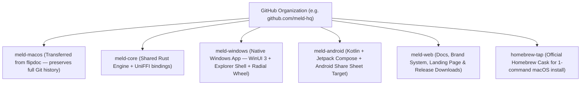

# Product Roadmap — From macOS Utility to Cross-Platform Local File Studio

## Vision
Build a **100% local-first, zero-cloud file transformation and productivity ecosystem** across **macOS**, **Windows**, and **Android**. Every operation runs directly on the user's device—preserving privacy, working offline on flights or restricted networks, and executing in milliseconds.

---

## Multi-Repository GitHub Organization Layout

Creating a dedicated GitHub Organization (e.g. `meld-hq` / `meld-app`) allows clean separation between the shared engine, native platform clients, design system, and distribution taps while preserving 100% of existing Git commit history via repository transfer:

---

## Phased Execution Plan

| Phase | Milestone | Key Deliverables |
| :--- | :--- | :--- |
| **Phase 1 (Current)** | **macOS v2.x Studio Foundation** | Radial modifier wheel (`⇧ Shift` Convert, `⌘ Command` Tools, `⌃ Control` Actions), Float Shelf, Offline VP8L WebP, Vision OCR, Remove BG, Portal Size Target Compress, PDF Lock/Stamp, 3-Up Study Handouts, QR Scanner & Permanent PII Redaction. |
| **Phase 2** | **Org Migration, Brand Identity & macOS v1.0 Public Distribution** | Transfer repo to GitHub Org, finalize brand tokens & icon suite, automated GitHub Releases (`.dmg` + `.zip`), Homebrew Tap (`brew install --cask`), and semantic versioning. |
| **Phase 3** | **Unified Operation Contract (`OperationRegistry`)** | Refactor internal engine calls behind a strongly-typed `OperationContract` (`op_id`, `input_types`, `params`, `output_naming`) so UI petals and sheets become declarative. |
| **Phase 4** | **`meld-core` Shared Rust Engine (via UniFFI)** | Extract OS-agnostic deterministic pipelines into Rust (`CSV/XLSX` parser & writer, `PDF` table clustering & geometry, `SRT/VTT` subtitle parser, PII regex/detector rules, lossless `WebP`, archive `.zip/.tar.gz`, and collision-safe `OutputNaming`). |
| **Phase 5** | **Windows Desktop Client (`meld-windows`)** | Native Windows 11 app featuring global file-drag hook + modifier radial overlay, Windows Explorer context menu (`Win+Shift`), Floating Shelf, and `meld-core` + Windows Media/OCR backend. |
| **Phase 6** | **Android Mobile Client (`meld-android`)** | Kotlin + Jetpack Compose app acting as a universal Android Share Sheet & Files receiver ("Share to MELD → Compress `< 200 KB` / Redact PII / Scan QR / Convert to PDF → Share immediately") powered by `meld-core` (via UniFFI JNI) + Android ML Kit. |

---

## Core Non-Negotiables
1. **Zero Cloud Uploads**: User documents, IDs, contracts, and photos never leave the device.
2. **Zero-Click Muscle Memory**: Never bury common actions inside 5-step wizards when a 1-second drag-and-release or share-sheet tap can solve it.
3. **Never Overwrite Originals**: Every operation outputs a cleanly named sibling file (`<Name>.<ext>` or `<Name> (1).<ext>`).
4. **Preserve Git History**: All rebranding and org moves use `git mv` and GitHub Repository Transfer so every commit and PR remains intact.
